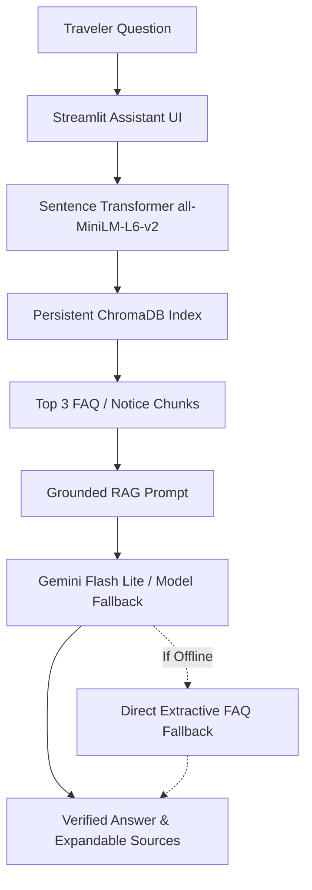

# TravelMate

TravelMate is an enterprise-ready Karnataka travel knowledge base and verified travel informationrmation portal built with fast Retrieval-Augmented Generation (RAG) and semantic vector search. Travelers and visitors can chat with an intelligent assistant for grounded answers, run instant semantic searches, view real-time travel notices, and submit unanswered questions to administration. College administrators log in with an admin password to manage FAQs (add single entries, edit, delete), review traveler inquiries, and publish official announcements.

---

## Key Features & Role-Based Permissions

### 1. Public Users & Travelers
* **🎓 AI Assistant**: Chat with a fast, grounded Karnataka travel companion citing verified FAQ and notice sources.
* **🔍 Instant Semantic Vector Search**: Natural-language semantic search across the entire ChromaDB knowledge base with real-time cosine similarity scores.
* **📢 Travel Updates & Circulars**: Browse official travel announcements with category tags, urgency badges, and keyword filtering.
* **❓ Ask / Post a Question**: Travelers can submit questions that are not yet answered in the FAQs. These inquiries are queued for administrator review.
* **📚 Browse FAQs**: Read-only directory of official Karnataka travel FAQs.

### 2. Administrator Portal (`🔐 Admin Portal`)
* **Secure Password Authentication**: Protected with admin credentials (`admin123` by default, configurable via `ADMIN_PASSWORD` in `.env`).
* **➕ Add Single FAQ**: Dedicated form to add a single question, answer, and category. The vector index automatically updates. (File upload has been removed to keep additions clean and controlled).
* **✏️ Edit & Delete FAQs**: Full authority to edit any existing FAQ question, answer, or category inline, or delete outdated entries with instant vector store synchronization.
* **📥 Answer Traveler Questions**: View questions submitted by travelers. Click "Answer" to publish a response and optionally convert the question and answer into an official FAQ for all travelers with one click.
* **📢 Publish & Manage Notices**: Create urgent or normal announcements, pin them to the top traveler alert banner, or activate/deactivate/delete notices.

### 3. High Performance & Fast Latency Optimizations
* **In-Memory Caching (`@st.cache_resource`)**: Pre-warms and caches the Sentence Transformer (`all-MiniLM-L6-v2`) in memory so warm queries avoid PyTorch initialization overhead.
* **Local Weights Isolation**: Employs `local_files_only=True` to eliminate unauthenticated HuggingFace Hub network checks that previously introduced delays.
* **Connection Pooling**: Reuses ChromaDB client and Google GenAI client singletons to eliminate repeated SSL handshakes and disk re-opening.
* **Fast Sub-Second Model Routing**: Prioritizes `gemini-flash-lite-latest` and `gemini-3.5-flash-lite` for crisp, fast answers, with automatic fallback across models.
* **Extractive Fallback**: If internet connectivity is interrupted, TravelMate instantly extracts direct answers from the top retrieved FAQ chunks so users never see an error.

---

## RAG Architecture



---

## Technology Stack

- **Frontend & Web App**: Streamlit
- **Vector Database**: ChromaDB (persistent cosine similarity index)
- **Embeddings**: Sentence Transformers (`all-MiniLM-L6-v2`, 384 dimensions)
- **Generative AI**: Google Gemini via `google-genai` SDK with multi-model fallback
- **Data Stores**:
  - `data/travel_faq.txt`: Official Karnataka travel knowledge bases
  - `data/notices.json`: Official travel updates and announcements
  - `data/submitted_questions.json`: Questions submitted by travelers
- **Testing**: Python `unittest` suite (22 fast offline tests)

---

## Project Structure

```text
TravelMate/
├── app.py                    # Streamlit interface with 5 role-based tabs
├── rag_pipeline.py           # Grounded answer generation and connection-pooled client
├── document_processing.py    # FAQ single entry management (add, edit, delete) & embeddings
├── vector_store.py           # ChromaDB indexing for FAQs, notices, and semantic search
├── notice_manager.py         # Official travel notice and circular management
├── question_manager.py       # Public submitted question handling
├── data/
│   ├── travel_faq.txt       # Official FAQ dataset
│   ├── notices.json          # Persistent travel notices and circulars
│   └── submitted_questions.json # Traveler submitted inquiries
├── tests/
│   ├── test_travelmate.py      # Core RAG and document parsing tests
│   └── test_enhancements.py  # Tests for single FAQ CRUD, questions, and notices
├── requirements.txt
├── .env.example
├── .env
├── .gitignore
└── README.md
```

---

## Installation & Setup

1. **Activate the virtual environment**:
   ```powershell
   .\.venv\Scripts\Activate.ps1
   ```

2. **Configure your environment**:
   Edit `.env`:
   ```dotenv
   GEMINI_API_KEY=your_gemini_api_key_here
   GEMINI_MODEL_NAME=gemini-flash-lite-latest
   ADMIN_PASSWORD=admin123
   ```

3. **Run the Streamlit application**:
   ```powershell
   streamlit run app.py
   ```

4. **Run the offline unit tests**:
   ```powershell
   python -m unittest discover -s tests -v
   ```


## TravelMate Karnataka adaptation
This project is adapted as a Karnataka-focused travel assistant. It retains the original Streamlit interface, document processing, embedding generation, ChromaDB semantic retrieval, Gemini-grounded RAG answer generation, source display, question submission, and admin management flow. The knowledge content now covers Karnataka destinations and trip-planning guidance. Verify time-sensitive details such as opening hours, transport schedules, weather, and ticket rules with official sources.
